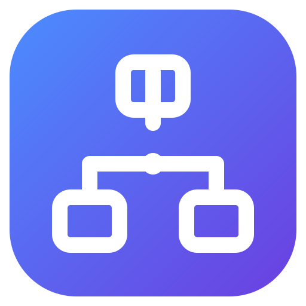

<p align="center">
  
</p>

<h1 align="center">OpenPacketLab</h1>

<p align="center">
  A free, open-source network simulator for learning and teaching networking.<br>
  No account. No sign-in. Your projects stay on your computer.
</p>

<p align="center">
  <a href="https://github.com/Lin8x/OpenPacketLab/actions/workflows/ci.yml"></a>
  <a href="https://github.com/Lin8x/OpenPacketLab/releases/latest"></a>
  <a href="LICENSE"></a>
</p>

Build topologies with routers, switches, PCs and servers, wire them up,
configure them through an IOS-style command line or a friendly settings
panel, and watch every frame move through the network in simulation mode.
The desktop app is a ~2 MB download and runs the same simulator as the web
build, which you can host yourself with Docker or Portainer.

## Features

**Devices and cabling**
- Routers (3 and 4 port models with serial WAN), access and multilayer switches, hubs, PCs, laptops, servers, printers, tablets, phones and IoT sensors
- Copper straight-through and crossover (MDI/MDI-X rules apply), fiber, serial DCE/DTE with clock rate, console (rollover), or let the automatic cable pick
- Power devices on and off, front panel view with port LEDs

**Switching**
- MAC learning, VLANs, 802.1Q trunks, dynamic trunk negotiation, native and allowed VLANs
- Spanning Tree (802.1D) with root election, port roles and states, PortFast and BPDU Guard
- Port security (sticky, maximum, violation modes), SVIs and inter-VLAN routing on multilayer switches

**Routing and services**
- Static and default routes, administrative distance, longest-prefix match
- RIPv2, OSPF (single area) and EIGRP with real metrics
- Router-on-a-stick subinterfaces, loopbacks, serial point-to-point links
- NAT (static, dynamic, PAT overload), standard and extended ACLs
- DHCP server, client and relay (`ip helper-address`), DNS, HTTP web server and browser, syslog
- ARP, ICMP (ping, traceroute), UDP and TCP, LLDP and CDP neighbors, Telnet and SSH between devices

**Command line**
- IOS-style modes, prompts and over 150 commands with abbreviations, `?` help, Tab completion, `no` forms and `do`
- `show running-config`, `show ip route`, `show ip interface brief`, `show vlan brief`, `show spanning-tree`, `show mac address-table`, `show ip ospf neighbor`, `show cdp neighbors` and many more
- Startup and running configuration, `copy run start`, `reload`, enable secrets, line passwords and VTY logins
- A PC command prompt with `ipconfig`, `ping`, `tracert`, `arp`, `nslookup`, `telnet` and `ssh`

**Simulation mode**
- Pause time and step through every event, or play at an adjustable speed
- Filter by protocol, inspect each packet layer by layer, and see why frames were dropped
- Animated envelopes on the canvas, one-click test pings (PDUs) with pass/fail status

**Made to be pleasant**
- A clean interface that follows Apple's Human Interface Guidelines: light and dark mode, SF-style typography, sheets, segmented controls and the command palette (`⌘K` / `Ctrl+K`)
- Every settings change shows the equivalent IOS commands, so the GUI teaches the CLI
- Automatic local backups with restore, undo and redo, recent files, duplicate and multi-select
- Backups to as many destinations as you like, each on its own schedule (every few minutes, daily, weekly on chosen days, on save, or manual) with per-lab retention, skip-if-unchanged, catch-up after the app was closed, and a history of every run. Destinations: a local folder or drive, network shares (SMB/NFS), Amazon S3 and compatible storage (R2, B2, Wasabi, MinIO), Google Drive, OneDrive, Dropbox, WebDAV (Nextcloud, ownCloud, Box), SFTP, FTP/FTPS, any HTTP endpoint, and any of rclone's 70+ backends
- Sample labs to start from: two LANs, VLANs, services, OSPF, NAT, spanning tree
- Open file format (`.opl`, JSON), configuration export, and no telemetry

## Install

### macOS (Apple silicon and Intel)

```sh
brew install --cask lin8x/tap/openpacketlab
```

Or download `OpenPacketLab_<version>_universal.dmg` from the [latest release](https://github.com/Lin8x/OpenPacketLab/releases/latest).
Builds are not notarized yet; if macOS says the app is damaged, run `xattr -dr com.apple.quarantine /Applications/OpenPacketLab.app`.

### Windows (x64 and ARM64)

Download the `.exe` installer or the `.msi` from the [latest release](https://github.com/Lin8x/OpenPacketLab/releases/latest), or use a package manager:

```powershell
winget install Lin8x.OpenPacketLab
scoop install https://raw.githubusercontent.com/Lin8x/OpenPacketLab/main/packaging/scoop-openpacketlab.json
choco install openpacketlab
```

### Linux (x86_64 and ARM64)

| Distribution | Command |
| --- | --- |
| Debian, Ubuntu, Mint, Pop!_OS | `sudo apt install ./OpenPacketLab_<version>_amd64.deb` |
| Fedora, RHEL, openSUSE | `sudo dnf install ./OpenPacketLab-<version>-1.x86_64.rpm` |
| Arch, Manjaro, EndeavourOS | `yay -S openpacketlab-bin` |
| Any distribution | Make the `.AppImage` executable and run it |
| Flatpak, Snap | Manifests in [`packaging/templates`](packaging/templates) |

ARM64 builds use `arm64` / `aarch64` in the file name.

### Docker and Portainer

```sh
docker run -d -p 8080:8080 --name openpacketlab ghcr.io/lin8x/openpacketlab:latest
```

Then open http://localhost:8080. The image is multi-arch (amd64, arm64, armv7, armv6, 386, ppc64le, s390x), runs as a non-root user with a read-only filesystem, and uses about 5 MB of memory.

**Portainer:** go to *Stacks → Add stack → Repository*, enter `https://github.com/Lin8x/OpenPacketLab` and the compose path `docker-compose.yml`. Or paste [docker-compose.yml](docker-compose.yml) into the web editor. Set `OPL_PORT` to change the port.

In the browser build, projects are saved as downloads (or with the File System Access API where available) and backups live in the browser's storage.

## Development

You need Node.js 20+ and, for the desktop app, Rust and the [Tauri prerequisites](https://tauri.app/start/prerequisites/).

```sh
npm ci
npm run opl -- doctor   # check your toolchain
npm run dev             # web UI at http://localhost:1420
npm run app:dev         # desktop app with hot reload
```

### Dev scripts

Plain bash scripts live in [`scripts/dev`](scripts/dev): `doctor.sh`, `test.sh`, `check.sh`,
`build.sh`, `docker.sh`, `backup-it.sh`, `release.sh` and more. See its [README](scripts/dev/README.md).

### Dev tool

`npm run opl -- <command>` (or `make <command>`) wraps the common tasks:

| Command | What it does |
| --- | --- |
| `doctor` | Checks Node, Rust, Docker, WebKitGTK and the GitHub CLI |
| `check` | Type check, tests, web build, `cargo fmt` and `clippy` (`--fast` for just types and tests) |
| `test [pattern]` | Runs the engine and CLI tests |
| `it` | Starts S3, WebDAV, SFTP and FTP servers in Docker and tests every backup destination against them |
| `size` | Reports the web bundle size |
| `bundle` | Builds desktop installers for your machine |
| `docker run` / `docker stop` | Builds and runs the container on port 8080 |
| `version <x.y.z\|patch\|minor\|major>` | Sets the version everywhere it appears |
| `release <x.y.z\|patch\|minor\|major>` | Runs the checks, bumps the version, dates the changelog, commits, tags and pushes |
| `notes <version>` | Prints the release notes CI uses |
| `manifests <version> --assets <dir>` | Renders the package manager manifests from release files |
| `lab <file.opl>` | Validates a project file |
| `clean` | Removes build output |

### Releasing

1. Add your changes under `## [Unreleased]` in [CHANGELOG.md](CHANGELOG.md).
2. Run `npm run opl -- release patch` (or `minor`, `major`, or an exact version).
3. The [Release workflow](.github/workflows/release.yml) builds macOS, Windows and Linux installers, the web zip and the multi-arch container image, publishes the GitHub release with checksums, and updates the package manifests.

Optional repository secrets turn on more channels:

| Secret | Enables |
| --- | --- |
| `HOMEBREW_TAP_TOKEN` | Pushing the cask to [Lin8x/homebrew-tap](https://github.com/Lin8x/homebrew-tap) (a token with write access to that repo) |
| `WINGET_TOKEN` | Submitting to winget-pkgs |
| `AUR_SSH_KEY` | Publishing `openpacketlab-bin` to the AUR |
| `CHOCO_API_KEY` | Publishing to Chocolatey |
| `APPLE_CERTIFICATE`, `APPLE_CERTIFICATE_PASSWORD`, `APPLE_SIGNING_IDENTITY`, `APPLE_ID`, `APPLE_PASSWORD`, `APPLE_TEAM_ID` | macOS signing and notarization |

### Cloud sign-in (Google Drive, OneDrive, Dropbox)

These services need an OAuth app. Register one with each provider and either build with
`VITE_GOOGLE_CLIENT_ID`, `VITE_GOOGLE_CLIENT_SECRET`, `VITE_ONEDRIVE_CLIENT_ID` and
`VITE_DROPBOX_CLIENT_ID` set (for example as repository variables in the release workflow), or
let users paste their own client ID under *Advanced* in the destination. The desktop app
signs in through the system browser with the redirect `http://localhost:53682/`; the web build
uses `<your site>/oauth.html`. Credentials are stored in a file only your user can read (desktop)
or in the browser's local storage (web).

### Project layout

```
src/engine/        simulator: scheduler, frames, devices, protocols, project format
src/engine/cli/    IOS-style command parser, commands, show output, PC prompt
src/backup/        backup destinations, schedules and the scheduler
src/ui/            Svelte interface (canvas, inspector, device windows, sheets)
src-tauri/         desktop shell (Rust, Tauri 2)
tests/             engine and CLI tests (Vitest)
packaging/         Homebrew, Scoop, AUR, winget, Chocolatey, Flatpak, Snap templates
scripts/opl.mjs    dev tool
```

See [CONTRIBUTING.md](CONTRIBUTING.md) for how to add commands, protocols and devices.

## License

Apache License 2.0. See [LICENSE](LICENSE) and [NOTICE](NOTICE).
OpenPacketLab is an independent project and is not affiliated with or endorsed by Cisco Systems or Apple.
